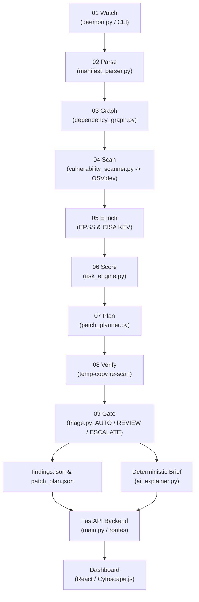

# Hyron AI — System Architecture (CSB-03)

## Purpose

Hyron AI is a local-first dependency incident response daemon for software supply chains. It continuously parses resolved npm lockfiles across repositories, builds a cross-project directed dependency graph to trace direct and transitive blast radius, matches packages against live OSV.dev vulnerability records enriched with FIRST EPSS exploit probability and CISA KEV known-exploitation signals, ranks findings using a transparent risk heuristic, and produces an ordered, semver-aware patch plan classified into AUTO, REVIEW, and ESCALATE safety tiers alongside deterministic, evidence-backed incident briefs.

---

## 9-Stage Control Loop (Data-Flow Diagram)

Hyron AI operates as a 9-stage control loop:

```
[01 Watch]        Lockfile changes / interval schedule / replayed advisory
      │
      ▼
[02 Parse]        npm package-lock.json (v2/v3) nearest-node_modules resolution
      │
      ▼
[03 Graph]        NetworkX directed dependency graph (projects -> direct -> transitive)
      │
      ▼
[04 Scan]         OSV.dev batch queries (advisories, affected ranges, fixed versions)
      │
      ▼
[05 Enrich]       FIRST EPSS exploit probability + CISA KEV known-exploited list
      │
      ▼
[06 Score]        Explainable risk formula (CVSS × Exploit Signal × Runtime Factor)
      │
      ▼
[07 Plan]         Smallest safe fix above current, same-major preferred, ordered by risk removed
      │
      ▼
[08 Verify]       Temp-copy lockfile re-scan (target CVE removed? zero new findings introduced?)
      │
      ▼
[09 Gate]         Policy classification: AUTO (low risk) | REVIEW (override) | ESCALATE (major/none)
      │
      ├───────────────────────────────┬───────────────────────────────┐
      ▼                               ▼                               ▼
findings.json                   patch_plan.json               Deterministic Brief
(all prioritized findings)     (ordered action plan)        (factual evidence summary)
      │                               │                               │
      └───────────────────────────────┼───────────────────────────────┘
                                      ▼
                             FastAPI JSON Endpoints
                         (/api/summary, /blast, /patch)
                                      ▼
                            Dashboard (React / UI)
```

### Mermaid Data-Flow Diagram



---

## Module Table

| File | One-line Job | Inputs | Outputs | Called by |
|---|---|---|---|---|
| `backend/main.py` | FastAPI application entry point and pipeline orchestrator | CLI args (`corpus/*/package-lock.json`) or HTTP requests | JSON API endpoints, static dashboard | User via CLI / Uvicorn |
| `backend/daemon.py` | Background file-watcher and scheduler for lockfile drift | Filesystem events in `corpus/`, polling timer | Scan triggers, state diffs, incident logs | Operator / systemd |
| `backend/triage.py` | Groups findings by CVE and assigns AUTO / REVIEW / ESCALATE tiers | `findings.json`, `patch_plan.json` | Per-CVE blast summaries and overall recommendations | Daemon, pipeline |
| `backend/make_corpus.py` | Generates sample npm projects with real lockfiles | Package pool, project count `N` | `corpus/app-XX/package-lock.json` files | Setup scripts, developer |
| `backend/services/manifest_parser.py` | Resolves npm v2/v3 lockfiles into directed graph nodes and edges | Path to `package-lock.json` | `networkx.DiGraph` (projects & packages) | `backend/main.py` |
| `backend/services/vulnerability_scanner.py` | Queries OSV.dev, EPSS, and KEV with local disk caching | `(package, version)` coordinate pairs | Parsed vulnerabilities, CVSS, fixed lists, exploit signals | `backend/main.py` |
| `backend/services/risk_engine.py` | Calculates transparent heuristic risk score and action tiers | CVSS, CVE, dev flag, EPSS map, KEV set | Float risk score (0–100), tier label | `backend/main.py`, `triage.py` |
| `backend/services/patch_planner.py` | Chooses safest fixed version and orders actions by risk removed | Finding rows with fixed version lists | Ordered list of patch action dictionaries | `backend/main.py` |
| `backend/services/dependency_graph.py` | Graph operations and serialization to Cytoscape.js format | `networkx.DiGraph`, target nodes | Cytoscape `{nodes, edges}` dicts, paths | Routes, main app |
| `backend/services/ai_explainer.py` | Generates deterministic, template-based incident briefs from facts | Finding dict, patch entry dict | Structured plain-text incident brief string | `routes/reports.py` |
| `backend/routes/scan.py` | HTTP POST endpoint to trigger pipeline dynamically | JSON `{ "paths": [...] }` | JSON status with finding counts | Frontend / API client |
| `backend/routes/graph.py` | HTTP GET endpoints for summary, blast radius, and top findings | Query params (`q=CVE-...`, `n=25`) | JSON summary, blast results, finding lists | Frontend / API client |
| `backend/routes/reports.py` | HTTP GET endpoints for patch plan and incident briefs | Query params (`project=...`, `cve=...`) | JSON patch actions, brief objects | Frontend / API client |
| `backend/schemas/scan_result.py` | Pydantic data models for request and response validation | Raw dictionary payloads | Validated Pydantic objects | Routes and main app |

---

## Exact JSON Shapes & Real Example Rows

### 1. `findings.json` (Real Row from app-01 Scan)

Each row represents one vulnerable package instance in a specific project along its shortest dependency path.

```json
{
  "project": "app-01",
  "package": "ejs@3.0.1",
  "vuln": "GHSA-phwq-j96m-2c2q",
  "cve": "CVE-2022-29078",
  "summary": "ejs template injection vulnerability",
  "cvss": 9.8,
  "epss": 0.32808,
  "kev": false,
  "dev": false,
  "direct": true,
  "depth": 1,
  "via": "ejs@3.0.1",
  "path": [
    "app-01",
    "ejs@3.0.1"
  ],
  "fixed": [
    "3.1.7"
  ],
  "risk": 45.3,
  "osv_url": "https://osv.dev/vulnerability/GHSA-phwq-j96m-2c2q",
  "instances": 1
}
```

#### Field Schema:
- `project` (str): Directory name of the affected project.
- `package` (str): Installed package name and version coordinate (`name@version`).
- `vuln` (str): Primary advisory identifier from OSV.dev (e.g. `GHSA-...` or `OSV-...`).
- `cve` (str | null): CVE identifier if aliased in OSV record.
- `summary` (str): Brief description of the vulnerability from advisory.
- `cvss` (float): CVSS v3 base score (0.0 to 10.0), or fallback severity.
- `epss` (float): FIRST.org Exploit Prediction Scoring System probability (0.0 to 1.0).
- `kev` (bool): True if CVE is actively cataloged in CISA Known Exploited Vulnerabilities.
- `dev` (bool): True if dependency is in `devDependencies` (reduced risk weighting).
- `direct` (bool): True if dependency is directly declared in root `package.json`.
- `depth` (int): Shortest hop distance from project root to vulnerable package.
- `via` (str): Human-readable dependency traversal string.
- `path` (list[str]): List of node labels traversed from project root to package.
- `fixed` (list[str]): Published versions that resolve this vulnerability.
- `risk` (float): Heuristic risk score (0.0 to 100.0).
- `osv_url` (str): Canonical reference URL on https://osv.dev/.
- `instances` (int): Number of duplicate installation paths collapsed into this finding.

---

### 2. `patch_plan.json` (Real Row from app-01 Scan)

Each row represents an aggregated remediation target for a package within a project, ordered by total risk removed.

```json
{
  "project": "app-01",
  "package": "axios",
  "current": "0.21.1",
  "target": "0.33.0",
  "direct": true,
  "via": "axios@0.21.1",
  "risk_removed": 322.6,
  "vulns": [
    "CVE-2021-3749",
    "CVE-2026-44492",
    "CVE-2025-27152",
    "CVE-2026-44487",
    "CVE-2026-25639",
    "CVE-2026-42039",
    "CVE-2026-44496",
    "CVE-2026-44486",
    "CVE-2026-42033",
    "CVE-2026-42035",
    "CVE-2026-42043",
    "CVE-2026-44495",
    "CVE-2026-42038",
    "CVE-2023-45857",
    "CVE-2026-67316",
    "CVE-2026-67319",
    "CVE-2026-42042",
    "CVE-2026-42034",
    "CVE-2026-42036",
    "CVE-2025-62718",
    "CVE-2026-40175",
    "CVE-2026-42041",
    "CVE-2026-44490",
    "CVE-2026-42040"
  ],
  "order": 1,
  "action": "npm install axios@0.33.0",
  "tier": "REVIEW"
}
```

#### Field Schema:
- `project` (str): Affected project name.
- `package` (str): Bare package name.
- `current` (str): Currently installed version string.
- `target` (str | null): Recommended safe target version, or null if no fix published.
- `direct` (bool): True if project directly declares the package.
- `via` (str): Shortest path representation.
- `risk_removed` (float): Cumulative risk points resolved if target version is adopted.
- `vulns` (list[str]): List of all CVE / advisory IDs resolved by upgrading to target.
- `order` (int): Rank order (1 = highest priority fix).
- `action` (str): Copy-pasteable action command or remediation instruction.
- `tier` (str): Safety gate tier (`AUTO`, `REVIEW`, or `ESCALATE`).

---

## Local Disk Cache & OFFLINE Mode

### Cache Location & Structure
- **File**: `.osv_cache.json` (stored in the repository root).
- **Contents**:
  - `ids`: Mapping of `"package@version"` to lists of advisory IDs returned by OSV.dev querybatch.
  - `vuln`: Full advisory detail dictionaries keyed by advisory ID (`GHSA-...`, `CVE-...`).
  - `epss`: Mapping of CVE IDs to EPSS probabilities.
  - `kev`: List of CVE IDs actively present in the CISA KEV catalog.

### What `OFFLINE=1` Does
When `env OFFLINE=1` is passed to any script or command:
1. All outbound HTTP network requests to `https://api.osv.dev`, `https://api.first.org`, and `https://www.cisa.gov` are completely suppressed.
2. The pipeline reads exclusively from `.osv_cache.json`.
3. If a package or vulnerability is present in the cache, its advisory data is used immediately.
4. If a package is not found in the cache during offline mode, it is treated as having no known vulnerabilities (empty list), allowing the demo and test suite to run deterministically with zero internet connectivity.
